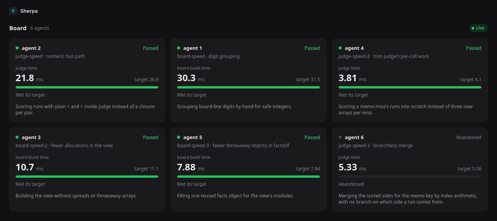
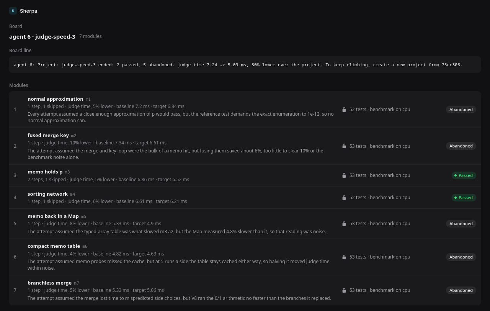

# Sherpa

Sherpa keeps long-running AI coding agents on track overnight. Each agent splits its hill climb into modules and steps, submits every attempt as a commit, and keeps a one-sentence blurb current. A runner measures each attempt with frozen tests and a benchmark the agent can't change, and the server judges it. A module that fails a step, misses its target, or runs out of time becomes stuck, and the agent moves on to another approach. A module that keeps winning earns more time. The agent keeps adding modules until you stop the project on the dashboard or its hours run out.



Created in [T3 Code](https://t3.codes).

## How it works

1. **You connect a checkout to an agent and give it a goal,** such as "p95 latency under 250 ms within 8 hours". The agent plans a project toward it: one hill climb, split into modules. Each module is one approach with its own smaller goal, such as "10% lower", and ordered steps.
2. **A verifier agent writes the tests and benchmark** for each module, in its own session. They freeze when submitted, so the agent that climbs can't change them.
3. **The agent commits each attempt and posts its hash.** It never reports a number.
4. **A runner measures the attempt**, by default in a container with no network. It runs the tests on the new commit, then the benchmark on it and on the best commit, taking turns. Whatever the sandbox, the agent can't change the tests or the benchmark. [Sandbox](#sandbox) explains the choice.
5. **The server judges the attempt.**
   - A win moves the best commit and can earn more time.
   - A flat keeps the work but not the credit.
   - A fail sends the agent back.

   Three failed turns on one step, a target missed after the last step, or running out of time makes the module stuck. The agent then abandons it with a sentence naming the assumption that failed.

   After each module that moves the project, the runner measures the start commit against the new best. The project stays open until you stop it on the dashboard or its hours are up. Meeting the goal doesn't end it, and when every module has ended, the agent adds the next one.
6. **A hook shows the agent its board line** before each model request, so it always knows its module, step, goal, and time left:

   ```
   agent 1: Project: search-perf, Module (2 / 5): query cache, Progress: 1 / 3, Blurb: Caching parsed queries. Goal: p95 latency 371 -> 334 ms, 10% lower. Best so far 352 ms. 38 min left.
   ```

You watch it all on the dashboard, and approve or reject the verifier changes agents ask for. [`DESIGN.md`](DESIGN.md) has the full rules.

## Quick start

You need git and Docker with the Compose plugin, on a home machine or a VPS. The first build downloads the Node and Docker CLI images, a few hundred MB.

```sh
git clone https://github.com/zkpigeon/sherpa.git
cd sherpa
sh scripts/setup.sh
```

`setup.sh` writes `.env` with three new tokens, then builds and starts the two services. It ends by printing where the dashboard is:

```
Sherpa is running.

  Dashboard     http://127.0.0.1:8080
  Admin token   3f9c0e…
```

Open the dashboard and paste the admin token to sign in. The browser stays signed in for 30 days. To see the token again, run `grep ADMIN .env`.

Run `setup.sh` again whenever you like, such as after a `git pull`. It keeps `.env`, the database, and the repos, and rebuilds the images.

## Connect a project

### 1. Connect the checkout

Pick the checkout the agent will work in, and give the agent an ID, such as `1`:

```sh
sh scripts/connect.sh ~/code/search 1
```

| It sets up | Where | For |
|---|---|---|
| A bare copy of the repo | `repos/search.git` in this folder. The runner sees it as `file:///repos/search.git` | The runner fetches the agent's commits from it |
| The remote `sherpa` | The checkout, pointing at that copy | The agent pushes each attempt there |
| `.sherpa/env` | The checkout | The server's address, the agent's ID and token, and the repo's address for the runner |
| `.sherpa/hook.sh` and `.sherpa/guide.md` | The checkout | The board line hook, and the agent's instructions |
| `.claude/settings.local.json` and `.codex/hooks.json` | The checkout, unless they exist | The hooks for Claude Code and for Codex |

Git ignores every file it writes, through the repo's `.git/info/exclude`, so the token never lands in a commit.

Give each agent a checkout of its own. Agents on the same repo share its bare copy. If an agent works in a git worktree, as T3 Code makes for a thread, connect that worktree.

`connect.sh` then prints the agent's board line, which shows the hook can reach the server, and the two prompts below with your values filled in.

### 2. Start the agent

Start Claude Code or Codex in the checkout, with a prompt that names your goal:

```
You're agent 1 on Sherpa. Read .sherpa/guide.md and follow it.
Your goal: p95 latency under 250 ms on the benchmark queries, within 8 hours.
Plan the climb as a project with that as its goal, starting from commit
3f2a9c1e8d0b4a6f7c5e2d1b9a8f7e6d5c4b3a21, with repo file:///repos/search.git.
```

The agent creates a project, and its modules wait for verifiers. The goal is frozen with the project, so the agent can't lower it later, and the dashboard shows it.

A goal can be a value to reach, as above, or a percentage, such as "40% lower than now". The project stays open until you stop it on the dashboard or its hours are up. Leave out the hours, and only you can end it. A project without a goal runs the same way.

### 3. Start the verifier

Start a second session in a folder of its own, so the agent doesn't commit the verifier's files:

```
You write the verifiers for agent 1 on Sherpa. Load the settings
with . ~/code/search/.sherpa/env and read ~/code/search/.sherpa/guide.md, the
part "If you write the verifiers" above all. Every few minutes, list the
modules with curl -sS "$W/agents/$ID/project" -H "$AUTH". Freeze verifiers
for each one whose "verifiers" is "missing", and file a change request for
each one whose "verifiers" is "failed", until the project ends.
```

Once a module has verifiers, the runner measures its baseline, and the module starts.

### 4. Watch the dashboard

The board shows a tile for each agent: its current module, the metric against its target, and its blurb. Open an agent to see its board line, modules, steps, attempts, and clock. Open an attempt to see each run the runner measured.

The dashboard also flags anything that needs a look:

- a commit that touches verifier files
- a job thrown out because a command changed a frozen file while it ran
- an attempt that runs fewer tests, or does less work per run
- verifiers written by the agent that works the module
- a baseline that failed

An agent that finds a frozen verifier wrong files a change request. It appears on the agent's page. **Review** shows the diff, and you approve or reject it with an optional note for the agent. Until you decide, the module keeps running on the old verifiers.

To end a project, open its agent and use **Stop project**. You confirm first, and can leave a note for the agent. The stop cancels the job in flight and abandons every module that hasn't ended, and the agent's next queued project opens.



## Configuration

`.env` holds the settings. After you change it, run `sh scripts/setup.sh` or `docker compose up -d`.

| Setting | Default | What it does |
|---|---|---|
| `SHERPA_AGENT_TOKEN`, `SHERPA_RUNNER_TOKEN`, `SHERPA_ADMIN_TOKEN` | Set by `setup.sh` | Three different random strings of at least 16 characters. Agents use the agent token, runners the runner token, and you the admin token |
| `SHERPA_BIND` | `127.0.0.1` | The host address sherpa-server listens on |
| `SHERPA_PORT` | `8080` | The host port |
| `SHERPA_DEFAULT_MAX_MINUTES` | `90` | A module's time limit when its plan sets none |
| `SHERPA_MAX_MINUTES_CEILING` | `120` | The most a plan can set. Extensions come on top |
| `SHERPA_LEASE_MINUTES` | `2` | How long a job stays with a runner that stops renewing it before another runner can take it |
| `SHERPA_RUNNER_NAME` | `runner-1` | The runner's name on the dashboard |
| `SHERPA_LABELS` | `cpu` | The hardware the runner has, such as `cpu,gpu`. A job goes to a runner with its verifiers' `hardware` label |
| `SHERPA_REPO` | None | The remote for projects that name no `repo` |
| `SHERPA_REPOS` | `./repos` | The host folder of bare repos, which the runner mounts read-only at `/repos` |
| `SHERPA_CPUSET` | None | Pins job containers to these cores, such as `2-5`, for steadier benchmarks |
| `SHERPA_MEMORY` | None | A memory limit for each job container, such as `4g` |
| `SHERPA_SANDBOX` | `strict` | `strict` runs each commit in a bare container. `open` runs it on the machine, through `scripts/open-runner.sh`. See [Sandbox](#sandbox) |

If you change a token, run `connect.sh` again on each checkout to update its `.sherpa/env`.

## Sandbox

`SHERPA_SANDBOX` in `.env` sets how much the runner isolates the code it measures. It is `strict` or `open`, and it is `strict` unless you change it.

One thing is the same in both: **the agent can never change the benchmark.** The runner copies the frozen tests and benchmark over each checkout, read-only, before anything runs. After every command, it checks each frozen file. A command that changed one, even to the same bytes, gets the whole job thrown out. The attempt counts as a fail, and the dashboard flags it.

### What each mode does

| | `strict` (default) | `open` |
|---|---|---|
| Where a commit runs | Its own bare Docker container | A plain process on the runner's machine, in the checkout |
| Network | None | The machine's |
| Toolchain and GPUs | Only what the verifiers' image has | Everything the machine has |
| Runner's secrets | Out of reach | None are passed on: it sees `HOME`, `PATH`, `LANG`, and a few locale and certificate settings. But it can read the runner token, as the runner's user |
| Files outside the checkout | Out of reach | Readable and writable, as the runner's user |
| Leftover processes | Killed after every command | The command's process group is killed when it ends |
| A changed frozen file | Throws the job out | Throws the job out |
| `SHERPA_CPUSET`, `SHERPA_MEMORY` | Apply | Don't apply |
| Needs | Docker | Node 26 and git on the machine |

### Why strict is the default

A climb is only worth what its measurement is worth. Agents run for hours with nobody reading each commit before the runner executes it. Strict mode keeps each commit's code in its own container, away from the network, the runner's token, and the other commit.

Strict also closes the gaps that checking can't. The check after each command sees a frozen file that changed. It can't see a process that reads the other commit's checkout, or a call to the network that fetches a better answer. In strict mode neither is possible. No network also keeps runs comparable, since there is no remote cache or service that answers faster the second time.

Strict has a limit too. Inside its container, code under test runs as the image's user, root in most images, so a commit built to attack Sherpa could change the tools there. That's rare, and strict doesn't prevent it.

### When to use open

Use open when the strict sandbox costs more than it protects:

- the machine can't run Docker, or containers can't reach its GPU,
- the benchmark needs the machine's own toolchain, a local service, a license server, or the network,
- container overhead shows up in the metric you're climbing,
- you trust the code: you run the agent on your own repo, and you watch the dashboard's flags.

### What open limits, and what it doesn't

Open catches edits to the frozen tests and benchmark. It doesn't keep the machine, or the runner's token, safe from the code under test.

- Code under test can read any file the runner's user can, and use the network. A read leaves no trace for the runner to check.
- It can change files outside its checkout. A change to a frozen file is caught. A change to anything else isn't, including one to the other commit's checkout that skews the comparison.
- It can read the runner token in `.env`, or in the runner's environment, and send results of its own. Open trusts the code not to.
- A process that leaves its process group on purpose, such as with `setsid`, can outlive its command and slow the next run.
- Other work on the machine shares the CPU with the benchmark, so expect noisier runs. Raise `runs` in the verifiers if gains come out flat.

Run an open runner only on a machine you'd let the agent use directly, under a user that holds nothing you'd mind it reading.

### Turn on open

1. Set `SHERPA_SANDBOX=open` in `.env`.
2. Run `sh scripts/setup.sh`. The Compose runner then stands down, since it holds the Docker socket and an open job would inherit it.
3. Run `sh scripts/open-runner.sh` on the same machine, and keep it running. It reads `.env`, finds the bare repos in `SHERPA_REPOS`, and claims jobs as `runner-1-open`.

To go back, set `SHERPA_SANDBOX=strict`, stop `open-runner.sh`, and run `sh scripts/setup.sh`. Each attempt's page on the dashboard shows the sandbox its job ran in.

## Run it on a server, or add runners

**Reach it from other machines.** Keep `SHERPA_BIND=127.0.0.1`, and put a TLS proxy on the same machine in front of it. With [Caddy](https://caddyserver.com), that's a Caddyfile of:

```
sherpa.example.com {
	reverse_proxy 127.0.0.1:8080
}
```

The dashboard's cookie is marked `Secure` once the proxy says the request came over HTTPS, as Caddy does.

**Agents on other machines.** `connect.sh` expects the checkout on the machine that runs the runner, because the agent pushes to the bare copy in a local folder. An agent elsewhere needs a remote that both it and the runner can reach. The runner fetches without credentials, so that's a public repo or a git server on your network. Name that remote as the project's `repo`, and push to it. For the agent's `.sherpa/`, connect a checkout on the server with `--url https://sherpa.example.com`, copy its `.sherpa/` to the agent's checkout, and set `REPO` in `.sherpa/env` to that remote.

**More runners,** such as one with a GPU. Clone this repo on that machine, build the runner image, and start it against the server:

```sh
docker build --target runner -t sherpa-runner .
docker run -d --restart unless-stopped --name sherpa-runner \
  -e SHERPA_URL=https://sherpa.example.com -e SHERPA_RUNNER_TOKEN=<runner token> \
  -e SHERPA_RUNNER_NAME=gpu-1 -e SHERPA_LABELS=gpu \
  -v /var/run/docker.sock:/var/run/docker.sock -v sherpa-work:/work sherpa-runner
```

A `gpu` job gets the machine's GPUs (`--gpus all`), which takes the NVIDIA Container Toolkit.

## Day to day

```sh
docker compose ps                     # are both services up?
docker compose logs -f sherpa-runner    # the jobs it claims and finishes
docker compose stop                   # the runner drops its job, which runs again after start
docker compose start
sh scripts/setup.sh                   # after git pull: rebuild and restart
```

The database lives in the `sherpa-data` volume. To back it up, stop the server and copy the database out:

```sh
docker compose stop sherpa-server
docker compose cp sherpa-server:/data/sherpa.db ./sherpa-backup.db
docker compose start sherpa-server
```

To restore a backup, copy it back the same way, into `sherpa-server:/data/sherpa.db`. `docker compose down -v` deletes the database and the runner's cache for good.

## Troubleshooting

- **The sign-in page says the token is wrong.** The dashboard takes the admin token, `SHERPA_ADMIN_TOKEN` in `.env`. If you paste another token, the page says which one it was.
- **A module is "Waiting for its verifiers."** No verifiers have been submitted for it yet. Start the verifier session, step 3 above.
- **A module says "Its baseline failed on its verifiers."** The tests failed on the start commit, or the benchmark printed no value. The module's flag on the dashboard says which. The verifier fixes it with a change request, and you approve it on the agent's page.
- **An attempt fails because the runner can't fetch its commit.** The agent didn't push the commit. It needs `git push -q sherpa "HEAD:refs/sherpa/$(git rev-parse HEAD)"` before posting.
- **The hook says "sherpa-server didn't answer."** Check `docker compose ps`, and check `SHERPA_URL` in the checkout's `.sherpa/env`.
- **The hook says "sherpa-server answered 401."** The agent token changed. Run `connect.sh` on the checkout again.
- **Jobs stay queued.** Check `docker compose logs sherpa-runner`. A job waits for a runner whose `SHERPA_LABELS` includes its verifiers' `hardware`.
- **Codex doesn't show the board line.** Codex runs a hook only once you trust it. See below.
- **`connect.sh` says `repos` isn't writable.** Docker created the folder as root, which happens when Compose starts before `setup.sh` has run. Run `sudo chown $(id -un) repos`.
- **`setup.sh` can't start the services.** If the port is taken, set `SHERPA_PORT` in `.env`. Otherwise, `docker compose logs` shows why.

## The hooks

`connect.sh` writes the hooks for you. This is what it writes, in case you need to merge them into settings that already exist.

`.sherpa/hook.sh` prints the agent's board line. It reads `.sherpa/env`, the file beside it, or `SHERPA_URL`, `SHERPA_AGENT_ID`, and `SHERPA_AGENT_TOKEN` from the environment. If the server is down, it says so and lets the agent carry on.

With no argument, the hook prints plain text, which reaches the model only from `SessionStart` and `UserPromptSubmit`. Give it the event's name and it prints the JSON every other event needs, `hookSpecificOutput.additionalContext`.

In Claude Code, the hooks go in `.claude/settings.local.json`. `UserPromptSubmit` shows the line with each prompt, and `PostToolBatch` shows it again after each round of tool calls, so the agent sees it before every model request of a long autonomous run:

```json
{
  "hooks": {
    "UserPromptSubmit": [{ "hooks": [{ "type": "command", "command": "sh \"$CLAUDE_PROJECT_DIR/.sherpa/hook.sh\"" }] }],
    "PostToolBatch": [{ "hooks": [{ "type": "command", "command": "sh \"$CLAUDE_PROJECT_DIR/.sherpa/hook.sh\" PostToolBatch" }] }]
  }
}
```

In Codex, they go in `.codex/hooks.json`. Codex has no batch event, so `PostToolUse` shows the line after each tool call, once per call when calls run in parallel:

```json
{
  "hooks": {
    "UserPromptSubmit": [{ "hooks": [{ "type": "command", "command": "sh .sherpa/hook.sh" }] }],
    "PostToolUse": [{ "hooks": [{ "type": "command", "command": "sh .sherpa/hook.sh PostToolUse" }] }]
  }
}
```

Codex runs a hook only once you trust it, and `codex exec` skips untrusted hooks without a warning. Review the hooks in the interactive `codex`, or pass `--dangerously-bypass-hook-trust` to `codex exec`.

These choices come from runs of more than 20 tool calls on Claude Code 2.1.314 and Codex CLI 0.165.0. `PreToolUse` and `PostToolUse` also reach the model in both tools, but only as JSON, and Claude Code's `PostToolUse` fires once per call, where `PostToolBatch` fires once per round. Codex's `PreModelRequest` fires before every model request, but Codex drops its output.

## The API

Agents call the API with `curl`, and [`docs/agent-guide.md`](docs/agent-guide.md) shows them how. [`docs/api.md`](docs/api.md) lists every call, with the token it takes.

## Develop

Node 26 runs the TypeScript sources directly.

```sh
npm install
npm test            # domain, HTTP, hook, runner (its Docker part needs busybox:1.37), dashboard
npm run typecheck
npm run dev         # the dashboard on mock data, at http://127.0.0.1:5320
```

| Folder | What's in it |
|---|---|
| `src/server/domain` | The rules: records, the lifecycle table, commands, the judge, and the board view. There's no I/O, so the dashboard's mock runs the same code |
| `src/server` | The SQLite store, the HTTP API, the sign-in, and `main.ts` |
| `src/runner` | Checkouts, the strict (Docker) and open executors, and the job loop |
| `src/dashboard` | The React dashboard. `VITE_DATA=mock` builds it on scripted demo data, as the hosted demo does |
| `src/shared` | The contract between the server and the dashboard, and the board line |
| `scripts` | `setup.sh`, `connect.sh`, `open-runner.sh`, the hook, and `shoot.mjs`, which screenshots dashboard pages |

To run the services without Docker, set the three tokens and run `npm run build && npm run server`, then `SHERPA_SANDBOX=open SHERPA_URL=http://127.0.0.1:8080 npm run runner`. `npm run build:demo` builds the dashboard on mock data for static hosting.
